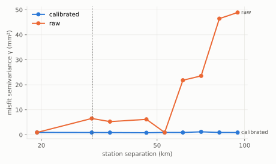
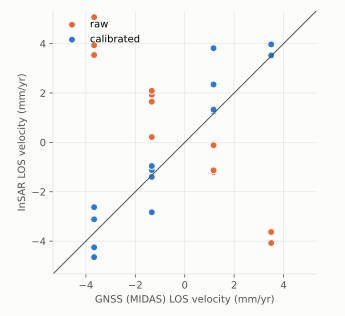
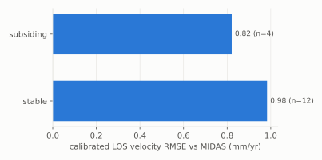

# 1. Validate a calibration

Run the validator on one candidate and read what it says.

## The frame

```bash
disp2vlm-validate demo demo
```

`demo/` now holds a small synthetic frame (`disp2vlm_validation.demo`):

| Path | What |
|---|---|
| `disp/` | 20 DISP-S1 pairs in two reference blocks (21 dates, 12 days apart), 40 × 60 pixels of 2 km |
| `perfect/`, `half/`, `none/` | three DISP-CAL candidates, laid out as cal-disp writes them: `products/<ref>_<sec>/OPERA_L4_DISP-CAL-*.nc` |
| `water_mask.tif`, `los.tif` | the land mask and the line-of-sight unit vector (east, north, up) on the DISP grid |
| `cache/` | the frame's frozen GNSS: MIDAS rates and daily positions of 16 stations |
| `configs/` | one `run.yaml` per candidate, and `gate.yaml` |

Truth is a 10 mm/yr east-west velocity gradient, seen with a vertical look.
Every DISP pair adds a random ramp across the frame, the long-wavelength
error a calibration exists to remove. The `perfect` candidate removes exactly
that ramp.

## The run

```bash
disp2vlm-validate run --config demo/configs/perfect.yaml
```

```text
F99999 perfect: PASS
```

What happened, in order (`disp2vlm_validation.pipeline.run_validation`):

1. **Stack.** Every DISP pair is matched with the candidate's DISP-CAL product
   by its reference and secondary dates. The calibrated displacement is
   `DISP − calibration`. Pairs are chained across reference blocks into one
   series per pixel.
2. **Velocities.** A streaming fit gives the raw and calibrated LOS velocity
   per pixel. The raw one does not depend on the candidate, so it is cached
   per stack in `cache/`.
3. **GNSS.** Station MIDAS rates and daily positions are projected to the
   line of sight. Each station is matched to its pixel; a 7 × 7 window median
   is used next to the pixel value.
4. **Metrics.** Velocity against MIDAS per station class, and the
   double-difference sill of InSAR minus GNSS for raw and calibrated.
5. **Gate.** The rules in [Metrics and gate](../guide/metrics.md) decide the
   verdict.
6. **Outputs.** `demo/runs/perfect/` (below).

## Reading the numbers

`demo/runs/perfect/metrics.json` holds everything the report shows. The two
numbers that matter most here:

| | raw DISP | calibrated |
|---|---|---|
| DD sill (mm²) | 8.12 | 0.92 |
| velocity vs MIDAS, 16 stations: median / RMSE (mm/yr) | – | +0.29 / 0.95 |

**The double-difference sill** is the one metric that compares raw and
calibrated on equal terms. For every pair of stations, the InSAR-minus-GNSS
misfit of their *relative* displacement series is reduced to a variance.
Differencing between stations cancels the datum, so the raw product's
arbitrary reference does not matter. The sill is the median over station
pairs far apart (here ≥ 30 km; ≥ 50 km on real frames): the long-wavelength
error. Calibration exists to remove it, so the sill must drop. Here it falls
by 89%.



**Velocity against MIDAS** checks absolute rates: the calibrated LOS velocity
at each station against the station's MIDAS rate in the same line of sight.



**Station classes.** Stations are sorted into classes because a single
number hides where a calibration fails. The demo has two: `subsiding` (GNSS
vertical rate below the threshold, 4 stations) and `stable` (12).



## The outputs

| File | What |
|---|---|
| `report.html` | verdict, sills with bootstrap intervals, velocity by class, figures, requirements traceability |
| `metrics.json` | every number in the report, plus the config hash |
| `stations.csv` | per station: position, MIDAS rates, LOS vector, InSAR at the pixel (`pix::`) and window median (`med::`), raw and calibrated, class |
| `station_series_mm.csv` | calibrated LOS series at each station |
| `calibrated_velocity_mm_yr.tif` | calibrated LOS velocity, GeoTIFF on the DISP grid |
| `sill_draws.npz` | bootstrap draws of each sill |
| `figures/*.svg` | the three figures above |

## Caching

Run the same command again and it returns at once. A run is cached by a hash
of the package version, the config and its input files; `--no-cache`
recomputes.

Next: [compare candidates and apply the gate](02-baseline-and-gate.md).
