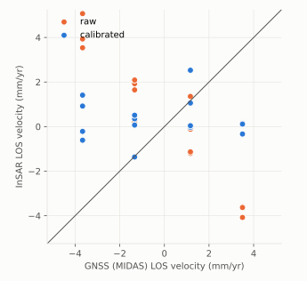

# 2. Compare with a baseline and apply the gate

A calibration is judged twice: against raw DISP (does it help at all?) and
against a baseline, the released algorithm (is the new one at least as
good?). This tutorial uses the demo from [tutorial 1](01-demo-frame.md).

## Point a candidate at its baseline

`demo/configs/half.yaml` differs from `perfect.yaml` in three lines:

```yaml
label: half
candidate_dir: .../demo/half          # this candidate's DISP-CAL products
baseline_dir: .../demo/runs/perfect   # the baseline's validation folder
```

`baseline_dir` is the output folder of the baseline's own run, not its
products. Run the baseline first.

```bash
disp2vlm-validate run --config demo/configs/half.yaml
disp2vlm-validate run --config demo/configs/none.yaml
```

```text
F99999 half: FAIL
  - DD sill up +265.8% [95% CI +152.2, +628.8] vs baseline (limit 5%)
  - velocity RMSE up +1.90 mm/yr vs baseline (limit 0.2)
  - velocity |median bias| up +0.37 mm/yr vs baseline (limit 0.2)
F99999 none: FAIL
  - DD sill not reduced by calibration (8.1 vs raw 8.1 mm²)
  - DD sill up +781.4% [95% CI +577.5, +2390.2] vs baseline (limit 5%)
  - velocity RMSE up +4.78 mm/yr vs baseline (limit 0.2)
  - velocity |median bias| up +0.46 mm/yr vs baseline (limit 0.2)
```

## The rules behind the verdict

`disp2vlm-validate gate` prints them; the numbers live in one place,
`disp2vlm_validation.requirements.GATE`.

| Rule | Fails when | `half` | `none` |
|---|---|---|---|
| GATE-1 | the calibrated DD sill is not below raw | 3.37 < 8.12 ✓ | 8.12 = 8.12 ✗ |
| GATE-2 | the sill rises more than 5% vs baseline **and** the 95% bootstrap interval excludes zero | +266% ✗ | +781% ✗ |
| GATE-3 | velocity RMSE vs MIDAS rises more than 0.2 mm/yr vs baseline | +1.90 ✗ | +4.78 ✗ |
| GATE-3 | velocity \|median bias\| rises more than 0.2 mm/yr vs baseline | +0.37 ✗ | +0.46 ✗ |

The sill comparison is *paired*: raw, candidate and baseline share the same
bootstrap resamples of stations, so their difference has a tight interval
even when each sill alone is uncertain. A rise that is not significant does
not fail.

The velocity rules use only stations outside deforming areas and event
footprints (decision 0002): inside them, a 50 km calibration surface is
expected to differ from a point measurement, and per-class targets judge
them instead.



## Per-class targets: notes or gates

A frame can add targets for station classes in a `gate.yaml`. The demo's:

```yaml
per_class_targets:
  stable: {max_abs_bias_mm_yr: 1.0, max_rmse_mm_yr: 1.0}
```

By default a target is **reported**: a miss becomes a note in `metrics.json`
and the report, not a FAIL. For `half`:

```json
"notes": ["stable: RMSE 2.26 > 1 mm/yr"]
```

A frame's *benchmark condition* gates instead (`gating: true`). Copy the
gate and the config, and make the stable class gating:

```yaml
# demo/configs/gate_gating.yaml
per_class_targets:
  stable: {max_abs_bias_mm_yr: 1.0, max_rmse_mm_yr: 1.0, gating: true}
```

```text
F99999 half-gating: FAIL
  ...
  - stable (benchmark condition): RMSE 2.26 > 1 mm/yr
```

Real frames use evidence-based targets rather than fixed numbers. Houston's,
for example, requires the subsiding class RMSE to stay below
`sqrt(raw² + reference²)`, where the reference error is the GNSS grid's own
accuracy from trade study TS-G1:

```yaml
per_class_targets:
  subsiding: {max_abs_bias_mm_yr: 1.0, rmse_must_drop_vs_raw: true,
              reference_rmse_mm_yr: 4.23, gating: true}
```

All target fields: [Configuration](../guide/configuration.md#gateyaml).

Next: [validate a real OPERA frame](03-real-frame.md).
