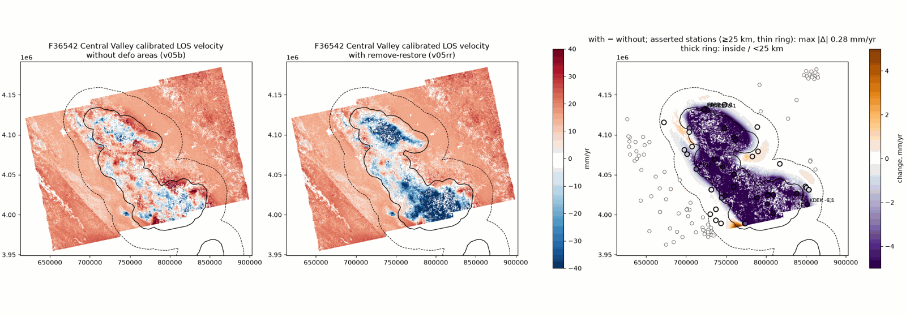
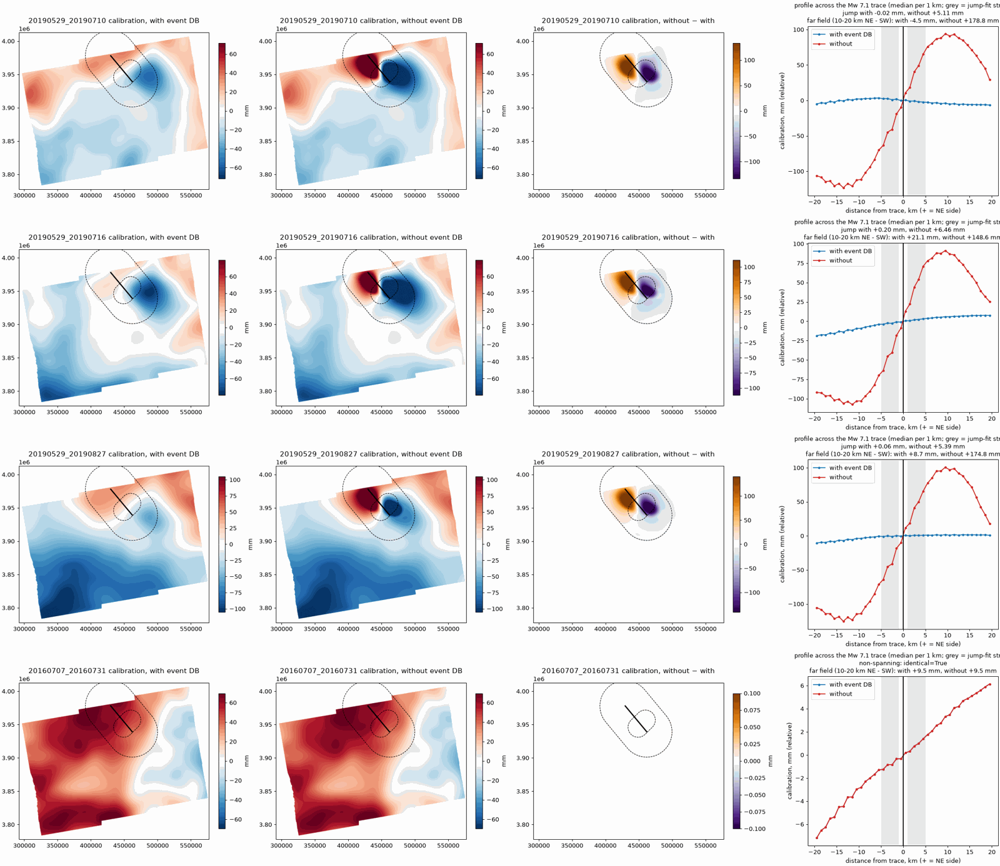

# T46.3: edge-case assertions (Central Valley, Ridgecrest)

**Status:** 2026-10-29. Both pass. Script: `studies/edge_cases.py`; tests in
`tests/test_studies.py` (`test_edge_cases_*`).

These are the benchmark conditions in PRD §2.7 that the gate does not
check: what the deforming-area and event databases may change and what they
must leave alone.

## Central Valley (F36542): stations away from the deforming areas

Runs compared:
- **Without areas:** `t46/runs/F36542/v05b`.
- **With areas:** `t46/runs/F36542/v05rr` (remove-restore, `exclude_defo_nodes`
  + `reinterpolate_excluded`, `t46/db/defo_area_db_v1.geojson`).

Both runs are full stacks (309 pairs) with the same algorithm parameters.
Between the two cal-disp commits only the remove-restore feature landed
(addec84 → a30b99e).

Change of the calibrated LOS velocity at the stations (`med::calibrated`):

| distance to the nearest area | stations | max \|change\| (mm/yr) | median \|change\| |
|---|---|---|---|
| inside | 20 | up to 75 | 18 |
| 0–10 km | 15 | 8.08 | 0.78 |
| 10–25 km | 9 | 1.55 | 0.12 |
| ≥ 25 km (asserted) | 83 | **0.28** | 0.06 |

**PASS:** max |change| < 0.5 mm/yr at stations ≥ 25 km from every area.



*Calibrated LOS velocity without and with remove-restore, and their
difference. Solid lines are the deforming areas, the dashed line is 25 km from
them. Thin rings are the asserted stations; thick rings are inside or within
25 km.*

The condition needs the distance. The plan's wording ("stations outside
unaffected") does not hold right at the bowl's edge, and should not:
- Without remove-restore, the 50 km surface carried the bowl's subsidence
  into its margin.
- The large near-edge changes move toward GNSS. Residuals (InSAR − GNSS,
  mm/yr):

| station | distance to area | without areas | with areas |
|---|---|---|---|
| MRCD | 0.4 km | 9.95 | 2.81 |
| MRC2 | 0.5 km | 9.53 | 1.40 |
| FPPB | 1.6 km | 8.01 | 1.95 |
| KDEK | 6.6 km | 11.81 | 5.67 |

The small near-edge changes (±1 mm/yr) go both ways. 25 km is half the 50 km
cutoff.

## Ridgecrest (F16941): the event database

Six pairs, each run twice on the same cal-disp commit (`cal_disp_sha.txt`) and
frame table:
- **With:** defo-area and event databases.
- **Without:** defo-area database only.

Runs are in `cal_disp_e2e/t46/edge`.

| pair | spans the event | with event DB | without event DB | |
|---|---|---|---|---|
| 20160707_20160731 | no | bit-identical | | PASS |
| 20190529_20190628 | no | bit-identical | | PASS |
| 20190908_20190926 | no | bit-identical | | PASS |
| 20190529_20190710 | yes | jump −0.02 mm | jump 5.11 mm | PASS |
| 20190529_20190716 | yes | jump +0.20 mm | jump 6.46 mm | PASS |
| 20190529_20190827 | yes | jump +0.06 mm | jump 5.39 mm | PASS |

**PASS:**
- Pairs that do not span the event are bit-identical with and without the
  event database.
- For spanning pairs, the calibration has no jump across the rupture
  (< 2 mm). Without the event database it has a 5–6.5 mm jump, so the check
  does detect a leak.



*Calibration with and without the event database, their difference, and a
profile across the Mw 7.1 trace. Rows: three spanning pairs, then one
pre-event pair.*

**The jump understates the leak.**
- Without the event database the coseismic signal enters the calibration as
  a smooth ±100 mm lobe pattern around the rupture, not as a sharp step.
  The 50 km surface cannot make a step, which is why the jump reads only
  5–6.5 mm.
- The far field shows the leak better: median 10–20 km NE of the trace minus
  10–20 km SW.

| pair | with event DB | without event DB |
|---|---|---|
| 20160707_20160731 (pre-event, normal surface slope) | +9.5 mm | +9.5 mm |
| 20190529_20190710 | −4.5 mm | +178.8 mm |
| 20190529_20190716 | +21.1 mm | +148.6 mm |
| 20190529_20190827 | +8.7 mm | +174.8 mm |

- With the event database, the far-field difference is in the range of the
  pre-event surface slope.
- 20190529_20190716 is about 11 mm above it. On the map, a −40 to −60 mm low
  remains at the SE end of the Mw 7.1 footprint in the 0710 and 0716 pairs.
  The footprint may be slightly short there; this is the T41.4 check of the
  draft footprints against the coseismic step.
- A far-field condition (for example |far-field difference − pre-event| <
  15 mm) would catch a leak that the step condition misses. Proposed, not
  adopted.

**How the jump is measured.**
- The rupture trace runs along strike through the Mw 7.1 epicentre, for the
  rupture length in the event database.
- Pixels in strips 1–5 km either side of the trace are fitted with
  `c0 + c1·across + jump·(side)`.
- A plain median difference of the two strips is not a jump measure: it grows
  with the strips' separation by about 0.5–1 mm/km, because the surface has a
  smooth slope there. With the event database it reads −3.4 / +4.5 / +1.0 mm
  for 1–5 km strips and −1.1 / +1.5 / +0.3 mm for 0.5–1.5 km strips. That
  slope is the remove-restore interpolation across the footprint, not a step.

## Reproduce

```bash
python studies/edge_cases.py cv --without t46/runs/F36542/v05b \
    --with t46/runs/F36542/v05rr --areas t46/db/defo_area_db_v1.geojson --out cv.json
python studies/edge_cases.py ridgecrest --with-event t46/edge/F16941-event/products \
    --without-event t46/edge/F16941-noevent/products \
    --events t50conf/inputs/event_db_v1.geojson --out ridgecrest.json
```

The paths are relative to `cal_disp_e2e`. The Ridgecrest products were made
with the e2e `calibrate_stack.py --epochs ... [--event-db ...]`
(`t46/edge/run_ridgecrest.sh`).
