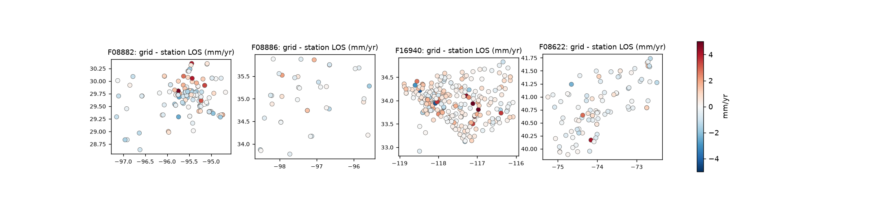
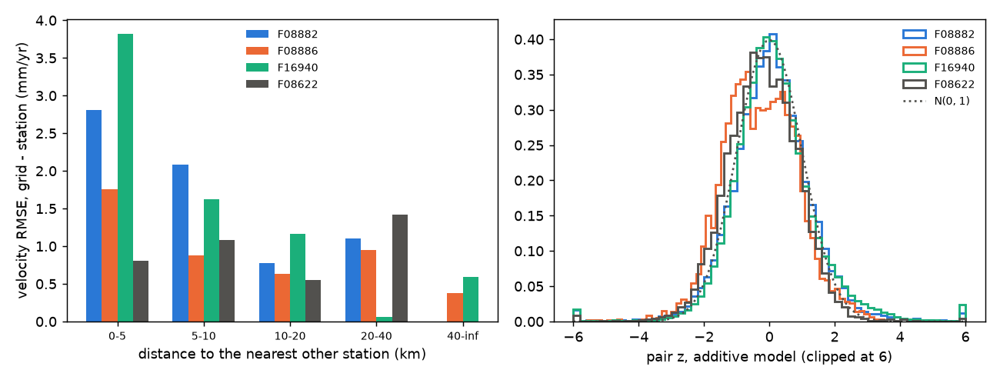

# TS-G1: UNR grid fidelity and k per frame

Venti plan T39, PRD §7.2 and R-E1. Run 2026-10-09 with `studies/ts_g1.py`
(driver: `run_all.sh`). Outputs on aurora:
`/mnt/aurora-z0/govorcin/cal_disp_e2e/ts_g1/<frame>/`.

## Question and method

- **Question:** how well does the interpolated UNR constant grid, as
  DISP-CAL samples it, match independent stations? What inflation k of the
  grid sigma makes σ_CAL realistic (R-E1)?
- **Grid sampling:**
  - `venti.gnss.sampling.sample_gnss_enu`, constant IGS20 grid v0.3, no
    buffer, as in the v0.5 runs;
  - sampled on a 500 m grid over the frame;
  - projected onto each station's own LOS vector.
- **Stations:** the MIDAS stations of the T38 validation, with UH01 excluded
  on F08882.
- **Held-out split:** `split_held_out`, 30% held out. k is fitted on the
  held-out stations and checked on the rest, so a station that sets k never
  validates it.
- **Two levels:**
  - **velocity:** r = grid LOS rate − MIDAS LOS rate, and
    z = r / √((k σ_grid)² + σ_station²);
  - **pair:** for every (ref, sec) pair of the DISP stack, r = grid rate × Δt
    minus the station's LOS displacement between the two dates (±3-day
    median), with σ_grid × Δt and the daily-scatter sigma of the station.
    This is the quantity σ_CAL describes.

## Results

Column key:
- **stations (fit/val):** all stations, with the held-out / validation split.
- **velocity r:** bias / RMSE / NMAD, in mm/yr.
- **σ_grid:** median, in mm/yr.
- **k (velocity):** std fit, with the robust fit in brackets.
- **val. std(z) / cov95 at k:** on the validation stations.
- **σ₀ (pair):** in mm.
- **pair val. robust std(z) / cov95:** additive model.

| frame | stations (fit/val) | grid nodes | velocity r | σ_grid | k (velocity) | val. std(z) / cov95 at k | σ₀ (pair) | pair val. robust std(z) / cov95 | pairs |
|---|---|---|---|---|---|---|---|---|---|
| F08882 Houston | 129 (44/85) | 106 | +0.07 / 2.48 / 1.17 | 0.62 | 1.35 (0.99) | 1.27 / 0.89 | 3.2 | 1.06 / 0.91 | 18 200 |
| F08886 OKC | 37 (18/19) | 120 | −0.01 / 1.27 / 0.56 | 0.20 | 3.39 (3.37) | 0.65 / 1.00 | 4.9 | 1.22 / 0.91 | 3 786 |
| F16940 LA | 279 (61/218) | 112 | +0.28 / 2.94 / 0.76 | 0.51 | 2.69 (0.94) | 1.10 / 0.90 | 2.6 | 1.00 / 0.91 | 57 147 |
| F08622 NYC | 89 (35/54) | 97 | −0.09 / 0.87 / 0.58 | 0.16 | 2.82 (2.27) | 0.73 / 0.98 | 3.9 | 1.05 / 0.94 | 10 377 |

## Findings

1. **The grid is unbiased at the stations.**
   - The velocity bias is within ±0.3 mm/yr on every frame.
   - The RMSE is 0.9–2.9 mm/yr, and the NMAD 0.6–1.2. The RMSE is driven
     by a few stations: the LA island and fault-zone sites, and Houston's
     subsidence bowls.
   - This also rules out the GNSS reference as the cause of the +3.7 mm/yr
     velocity bias of the calibrated DISP (disp2vlm_validation#2).
2. **Misfit is largest where stations are densest.**
   - The RMSE is 2.8–3.8 mm/yr below 5 km spacing on Houston and LA, and
     about 1 mm/yr beyond 10 km.
   - Dense clusters sit in urban areas that are deforming (subsidence,
     basins, faults). Their short-wavelength motion is what a 50 km
     calibration should not take from the grid anyway (remove-restore,
     T32).
   - So sparse coverage is not where the grid fails on these four frames.
     Frames with sparse GNSS (T40, the Great Basin) still need checking.
3. **k at the velocity level is 1.4–3.4, below the 3.9 placeholder.**
   - The robust fit gives about 1 on Houston and LA, so a handful of
     outliers drive the plain fit there.
   - OKC is fitted on only 18 stations. Its validation std(z) of 0.65 says
     k = 3.4 is conservative there.
4. **At the pair level, a multiplicative k cannot work.**
   - The pair residual hardly depends on Δt: 3–5 mm for 12-day pairs and
     4–7 mm at half a year. That is seasonal and other non-secular station
     motion that a constant-velocity grid cannot carry.
   - σ_grid × Δt goes to zero for short pairs. A k that fits them is
     50–100, and one fitted on all pairs over-inflates long pairs.
   - An **additive** term works on all four frames:
     σ² = σ₀² + (k σ_grid Δt)² + σ_station², with **σ₀ = 2.6–4.9 mm**.
     Held-out robust std(z) is 1.00–1.22 and coverage 0.91–0.94 overall,
     within R-E4.
   - Per Δt bin it is weakest at 0.25–1 yr: robust std(z) up to 1.44 and
     coverage down to 0.76 (F16940, 0.5–1 yr). That is the seasonal peak, and
     it suggests σ₀ should grow with the seasonal amplitude rather than stay
     constant.
   - The pair-level k is not identifiable: it is 2.6 / 7.2 / 42 / 59. Where
     σ_grid is tiny (OKC, NYC), k absorbs the half-year seasonal peak.
     Take k from the velocity level.

## Recommendation

- **k per frame** (frame table, T39.3; `k_source: TS-G1`):

  | frame | F08882 | F08886 | F16940 | F08622 |
  |---|---|---|---|---|
  | k | 1.35 | 3.39 | 2.69 | 2.82 |

  - These are the std fits on held-out stations.
  - Keep 3.9 as the default for frames without a fit.
- **Add σ₀ to σ_CAL.**
  - R-E1's σ_ref term already exists in `venti.calibration.uncertainty.sigma_cal`,
    but it is not exposed in `UncertaintyOptions`.
  - Proposal: `uncertainty.sigma_station_mm` (float, or `frame_table`).
    Per frame, from this study: 3.2 / 4.9 / 2.6 / 3.9 mm. Default 0, which
    keeps current output.
  - Without σ₀, σ_CAL is too small for short pairs by a factor of 5–20 at
    any k.
  - **Owner decision:** whether σ_CAL should include non-secular station
    motion (seasonal loading) or document it, as is planned for σ_DISP
    (R-E2, TS-S1).
- **Does σ_grid encode support (T39.4)?** Only weakly. σ_grid is larger
  where the nodes are less constrained: 1.7 mm/yr at 5–10 km on Houston
  against 0.3 at 10–40 km. But the residual is driven by local deformation
  near dense clusters, which σ_grid does not see. No separate support layer
  is needed (D5 stands); the σ₀ term and remove-restore cover the gap.

## Caveats

- **The stations are not fully independent of the grid.** GPS Imaging
  builds the grid from the same UNR stations, so velocity-level misfit is a
  lower bound on the grid error between stations. A leave-one-out grid
  would need re-running GPS Imaging per station, which is out of scope.
- **k at the velocity level rests on 18–61 fitting stations per frame.**
  F08886 is the weakest.
- **σ₀ mixes station noise beyond the daily scatter with real non-secular
  motion.** It is not a grid property. It belongs in σ_CAL only if the
  product's σ is meant to cover a pair's departure from secular motion.
