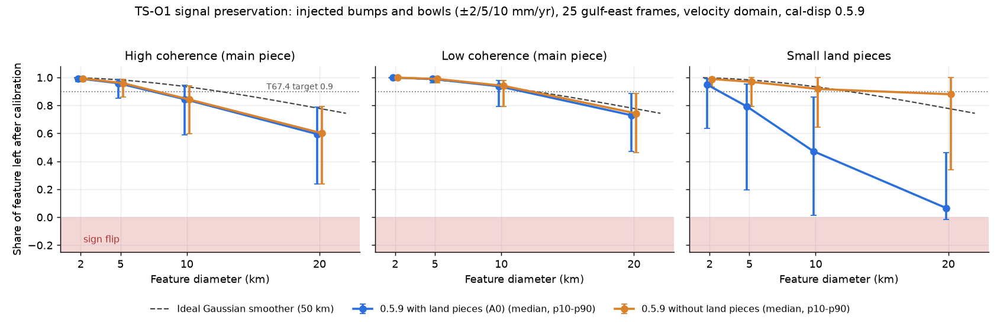

# TS-O1 measures (Venti plan T67.1)

The calibration surface should carry only the long-wavelength field tied to GNSS. Features
shorter than the 50 km cutoff should pass through it unchanged (Venti T67). This report gives the
two T67.1 measures for the current setting, before any T67.2 arm is scored. Code:
`studies/ts_o1.py` (functions and tests) and cal-vlm-batch `campaigns/overshoot_qa.py` (the
campaign QA flag). Run folder on aurora: `/mnt/aurora-z0/govorcin/cal_disp_e2e/ts_o1` (`README.md`,
drivers in `code/`, per-feature results in `out/synth_all.csv`, `out/overshoot_v059_25.csv`).

The thresholds in `ts_o1.py` were fixed before any arm was scored. They must not be tuned on arm
results (T67.4).

## (a) Signal preservation

Gaussian bumps and bowls were injected into the raw velocity of the 25 gulf_east_val frames
(`gulf_east_val/vel_domain/in`). The frames were then calibrated in the velocity domain with
`cal-disp:0.5.9` (Venti 6c16457).

- **Features:** diameters of 2, 5, 10 and 20 km, at ±2, ±5 and ±10 mm/yr, on three ground classes:
  - high coherence: top quartile, main land piece;
  - low coherence: bottom quartile, main land piece;
  - small land pieces: below `piece_min_pixels`, with the feature confined to the piece.
- **Spacing:** features in one run are at least 60 km plus their diameter apart (about six kernel
  sigmas).
- **Survival** = 1 − mean(surface change) / mean(feature), over the feature core (r ≤ D/4). Below
  0 is a sign flip.
- **Ideal** = an ideal Gaussian smoother with the same kernel (sigma 9.4 km).
- **Arms:**
  - A0, the campaign setting since `na-redo-v059`: `regions=pieces`, `small_pieces=offset`, the
    campaign land-piece map and fit mask;
  - the same setting without land pieces (`regions=none`).
- **Count:** 2,832 features (1,416 per arm).

Median survival (p10 in brackets):

| Ground | D (km) | Ideal | A0 | Without pieces |
|---|---|---|---|---|
| High coherence | 2 | 1.00 | 0.99 (0.97) | 0.99 (0.97) |
| | 5 | 0.98 | 0.96 (0.85) | 0.96 (0.86) |
| | 10 | 0.93 | 0.84 (0.59) | 0.84 (0.60) |
| | 20 | 0.78 | 0.59 (0.24) | 0.60 (0.24) |
| Low coherence | 2 | 1.00 | 1.00 (1.00) | 1.00 (1.00) |
| | 5 | 0.98 | 0.99 (0.96) | 0.99 (0.96) |
| | 10 | 0.93 | 0.94 (0.79) | 0.94 (0.79) |
| | 20 | 0.78 | 0.73 (0.47) | 0.74 (0.46) |
| Small land pieces | 2 | 1.00 | 0.95 (0.64) | 0.99 (0.93) |
| | 5 | 0.98 | 0.79 (0.20) | 0.97 (0.79) |
| | 10 | 0.93 | 0.47 (0.01) | 0.92 (0.65) |
| | 20 | 0.78 | 0.07 (−0.02) | 0.88 (0.34) |

Features of 10 km or less:

| Arm | Ground | Median | Share ≥ 0.9 | Sign flips |
|---|---|---|---|---|
| A0 | high coherence | 0.96 | 0.70 | 0 of 450 |
| A0 | low coherence | 0.99 | 0.91 | 0 of 162 |
| A0 | small pieces | 0.78 | 0.34 | 11 of 450 |
| Without pieces | high coherence | 0.96 | 0.71 | 0 of 450 |
| Without pieces | low coherence | 0.99 | 0.91 | 0 of 162 |
| Without pieces | small pieces | 0.97 | 0.77 | 0 of 450 |

What the numbers show:

1. **Low-coherence ground behaves like the ideal smoother.**
2. **High-coherence ground loses more than the ideal smoother:** 0.84 against 0.93 at 10 km, and
   p10 0.59. This is overshoot mechanism 2 of T67, coherence-weight dominance: a bright feature
   carries more of the kernel's weight, so the surface follows it.
3. **Small land pieces lose their own features under A0.** The cause is the per-piece offset
   (`small_pieces=offset`): one constant per piece takes out the piece's mean misfit, and with it
   any feature that fills the piece. Survival does not depend on amplitude (0.72 to 0.83 at
   ±2/5/10 mm/yr), so the 5 mm/yr island-pass threshold is not what drives it. This is mechanism 1
   of T67, small regions. Without land pieces, small pieces keep 0.92 at 10 km.
4. **Arm A0 does not meet the T67.4 preservation condition** (≥ 0.9 for features up to 10 km, no
   sign flips) on small land pieces. The condition is met on low-coherence ground, and on
   high-coherence ground the median meets it but p10 does not.

The surface is a little non-linear (robust weights, coverage blend), so survival is measured, not
computed from the kernel. Features on small pieces are cut at the piece outline. At 20 km the
feature is then smaller than its nominal size, which is why that arm can sit above the ideal
curve.

## (b) Overshoot on real data

The per-pair products of `na-redo-v059` were used for the same 25 frames: the chained raw and
calibrated velocity of the same window, at 300 m.

- **Anomaly** = median in the segment minus median in a 0.15° ring around it.
- **Added** = calibrated minus raw anomaly.
- **Segments:**
  - small land pieces (campaign map, ≥ 1 km²);
  - coherent clusters (above the frame's p90 coherence, 1–400 km²);
  - the owner's review polygons, held out.
- **Flags:**
  - flip: |raw| ≥ 1, |cal| ≥ 0.5 and the sign changes;
  - inject: |raw| < 0.5 and |added| > 1;
  - |raw| ≥ 10 mm/yr: unwrap-like (T62), reported apart.

Results, without the unwrap-like cases:

| Segments | n | Flip (of \|raw\| ≥ 1) | Inject | Median \|added\| (mm/yr) | Median added/raw |
|---|---|---|---|---|---|
| Coherent clusters | 4,970 | 0.003 | 0.002 | 0.11 | −0.06 |
| Owner polygons | 20 | 1 of 5 | 0.05 | 0.33 | −0.41 |
| Small land pieces | 433 | 0.295 | 0.051 | 1.60 | −0.85 |

The real data agree with (a):

- coherent clusters keep their signal on the products;
- small land pieces lose about 85% of their anomaly and flip in 30% of cases.

The campaign QA flag (`overshoot_qa.py`) marks a frame for review at five or more non-stress
flips plus injections. It marks 8 of the 25 frames: F00833, F00834, F12638, F16668, F16669,
F28220, F44054 and F44055. That level is a triage level only. It is not part of the decision rule.

## For T67.2

- The measures point at arm A1 (region-size rule) for small pieces and A2 (weight-share cap) for
  high-coherence ground.
- Island offsets that correct real unwrap errors are T62's. They show up as unwrap-like cases
  (|raw| ≥ 10). A1 has to keep those corrections while it stops absorbing real signal on small
  pieces. The unwrap-like cases on small pieces (51 of 484) are the check for that.
- What counts as "preservation ≥ 0.9" (median, or a share of features) is open; this report gives
  both. The owner settles it before T67.2 starts, when the rule freezes.
