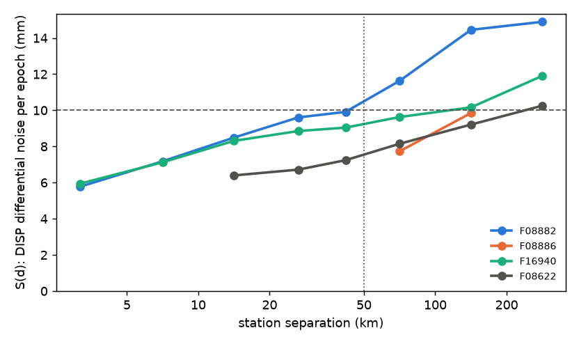

# TS-S1: DISP noise below the calibration cutoff

Venti plan T43, PRD R-E2 and §7.2. Run 2026-10-09 with `studies/ts_s1.py` on
the T38 v0.5 runs (calibrated DISP, troposphere off). Outputs on aurora:
`/mnt/aurora-z0/govorcin/cal_disp_e2e/ts_s1/<frame>/`.

## Question and method

DISP-CAL removes wavelengths longer than about 50 km. Whatever is left
between two points closer than that is DISP's own noise. The product tells
users to add it themselves, using a 10 mm placeholder today. How large is
it, per frame?

For every station pair, the double difference of (calibrated DISP − GNSS)
LOS series has

    rmse² = var(DISP differential) + σ_GNSS,1² + σ_GNSS,2².

- **GNSS noise:** each station's daily white noise (1.4826 MAD of first
  differences / √2), subtracted per pair.
- **Structure function:** S(d) = √(median DISP differential variance) in
  distance bins.
- **Headline number:** S pooled over all pairs 10–50 km apart, which needs
  no model.

S(d) is the **per-epoch** noise of the displacement difference between two
points d apart. For one point against a perfect reference, divide by √2.

## Results

| frame | stations | pairs 10–50 km | S(10–50 km), pair | per point | S(0–10 km) | ρ(scatter, coherence) | σ_GNSS daily |
|---|---|---|---|---|---|---|---|
| F08882 Houston | 116 | 1 807 | **9.6 mm** | 6.8 | 6.7 (194 pairs) | −0.14 | 2.8 |
| F08886 OKC | 18 | 7 | 5.5 | 3.9 | 3.1 (4 pairs) | −0.58 | 3.0 |
| F16940 LA | 244 | 5 878 | **8.9 mm** | 6.3 | 6.8 (336 pairs) | −0.22 | 2.4 |
| F08622 NYC | 85 | 469 | **7.0 mm** | 4.9 | 3.7 (23 pairs) | −0.25 | 2.7 |

- **S(d) is nearly flat beyond a few km.**
  - On the well-sampled frames, S grows only from about 6 mm at 3 km to
    9–10 mm at 50 km.
  - A power law fits with α = 0.2–0.3 (Houston, LA).
  - Most of the noise is short-correlation: turbulent troposphere (off in
    these runs) plus decorrelation noise.
  - It rises beyond 50 km, as expected. That part is what the calibration
    removes, and these are calibrated series, so it is the calibration's
    residual.
- **The nugget + power-law fit is fragile** where pairs closer than 50 km
  are scarce.
  - OKC has no bin with ≥ 20 pairs, so no fit.
  - NYC fits only 3 bins: nugget 6.2 mm, α 1.6, unstable.
  - The pooled 10–50 km number is the robust quantity.
- **Temporal coherence is not a usable proxy.** Spearman ρ between a
  station's DISP residual scatter and its pixel coherence is −0.14 to −0.25
  where the sample is large. OKC's −0.58 comes from 18 stations.
  `timeseries_inversion_residuals` was not tested; the stack layer was not
  read.

## Recommendation for the product spec (R-E2)

Replace the bare "10 mm" with a statement that matches the evidence:

> DISP-CAL does not correct DISP noise at wavelengths shorter than about
> 50 km. On the four validation frames (troposphere uncorrected), the
> per-epoch noise of the displacement difference between two points 10–50 km
> apart is 6–10 mm (1σ); for a single point it is 4–7 mm. Use 10 mm as a
> conservative per-epoch value for point differences within 50 km.

- Keep `sigma_disp_placeholder_mm = 10` as the documented value. It is a
  fair upper bound on these frames.
- Revisit it after the 8-frame set (T46): sparse GNSS, high relief, and
  frames with troposphere correction on.
- Do not add a coherence-based per-pixel σ_DISP.

## Caveats

- **The station series are 7 × 7 pixel medians (~210 m).** S is the noise
  of that average, a lower bound for a single 30 m pixel.
- **Stations sit on coherent pixels.** Low-coherence areas are
  under-represented, which also weakens the coherence proxy test.
- **The GNSS white-noise estimate ignores coloured GNSS noise.** If anything,
  that overstates S slightly.
- **All runs have the troposphere uncorrected**, so the short-range
  turbulent part is included.
