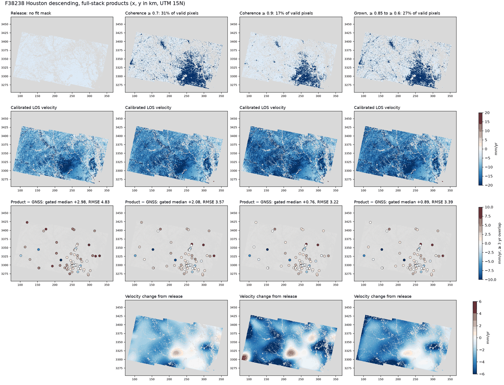

# Fit masks for the Houston frames (F38238, F08882)

**Status:** 2026-10-31. A grown stable-pixel mask brings F38238 under the
1 mm/yr bias target and improves the Houston VLM. Nothing is adopted: the frame
table and products are unchanged until the owner decides. Tool: Venti
`venti-fit-mask --grow-floor` (venti-dev #54).

All numbers use decision 0005 (at least 3 years of GNSS in the stack). Products
are full stacks on cal-disp v0.5.7 code (cf0ab61) unless marked as a fast test.
Runs are under `cal_disp_e2e/t57/f38238_fitmask`, `f38238_bias` and `f08882_bias`.

## Why F38238's bias is high

F38238 passes the gate, but its gated median bias of +2.98 mm/yr is above the
1 mm/yr target. Using TS-G1 on this frame:

| Term, median at the 30 gate stations | Release | Coherence ≥ 0.7 |
|---|---|---|
| Calibrated − GNSS | +2.98 | +2.08 |
| Grid − station | −0.42 | −0.42 |
| Station pixel − fitted surface | +2.64 | +1.44 |

The UNR grid is not the cause. The surface settles below the station pixels.

## The grown mask

A plain threshold trades bias against coverage: stricter masks keep mostly
metro Houston and a few towns. The grown mask, proposed by the owner, keeps both:

1. **Seeds:** stack-mean temporal coherence ≥ 0.85.
2. **Growth:** at each level down to 0.6 (steps of 0.05), add pixels within 2 km
   of the mask that have a stack velocity within 2 mm/yr of the seeds' local
   velocity and mean phase similarity ≥ 0.8.

The inputs are DISP only. Stations score the result and choose no pixel.

In fast velocity-domain tests, velocity similarity does most of the work:
growing on phase similarity alone gave median +1.44 and RMSE 2.98, against +1.00
and 2.78 for the recipe. Velocity alone was nearly equal to the recipe (+1.00,
2.78).

## F38238

Gate verdict is PASS for all. mm/yr.

| | Release | ≥ 0.7 | ≥ 0.85 | ≥ 0.9 | Grown |
|---|---|---|---|---|---|
| Gated median (n=30) | +2.98 | +2.08 | +1.07 | +0.76 | **+0.89** |
| Gated RMSE | 4.83 | 3.57 | 3.26 | 3.22 | **3.39** |
| Gated NMAD | 4.21 | 2.44 | 1.67 | 1.68 | **1.65** |
| All-station median (n=77) | +2.51 | +1.27 | +0.87 | +0.72 | **+0.87** |
| All-station RMSE | 4.45 | 3.50 | 3.27 | 3.09 | **3.38** |
| DD sill vs release | | −17% | −20% | −21% | **−20%** [−31, −9] |
| Subsiding RMSE (n=5) | 3.79 | 2.32 | 1.78 | 1.63 | **1.80** |
| Stable RMSE (n=17) | 5.95 | 4.46 | 4.13 | 4.09 | **4.30** |

**Why not ≥ 0.9, which scores slightly better.** It leaves about +6 mm/yr of
change in the SW corner, where the mask is too thin to hold the surface. The grown
mask does not show it. The mask's stable share of land is 16% (≥ 0.9: 10%), and no
land is more than 8.3 km from a mask pixel (≥ 0.9: 15.8 km).

**A control.** One pair calibrated with no mask on the same code is bit-identical
to the release product, so these differences come from the mask.

### What it does not fix

| Station residual | Release | Grown |
|---|---|---|
| TXLI | +11.0 | +7.0 |
| JGS2 | +8.1 | +4.3 |
| TXCV | +9.8 | +8.2 |
| KPCS | −10.8 | −10.3 |
| LCBR | −6.6 | **−11.2** |

- **Unexplained residuals:** TXCV and KPCS barely move, and LCBR gets worse. Their
  cause is not established.
- **East of Houston:** the area around (300, 335) km changes by about −6 mm/yr with
  every mask.
- **Frame edges:** the west and north edges change by 4–6 mm/yr, with few stations
  to check it.

## F08882

The same recipe, set before looking at this frame. The current mask is the packaged
coherence ≥ 0.7. mm/yr; sill against the current product.

| | Current | Grown |
|---|---|---|
| Gated median (n=50) | +0.37 | **+0.20** |
| Gated RMSE | 4.36 | **4.20** |
| Gated NMAD | 2.45 | **2.17** |
| All-station RMSE (n=98) | 3.31 | **3.18** |
| Subsiding RMSE (n=19, limit 2.53) | 4.97 | **4.87, fails** |
| DD sill | | **−4.7%** [−7.0, −1.5] |

The frame improves modestly but still fails its benchmark condition (decision
0006). TXGA stays at −15.8 and GAL2 at −9.4, which a fit mask cannot fix. TXBC and
TXMG are slightly worse (+6.4 → +7.1, +6.3 → +6.6).

The farthest land from the mask is 38 km, but land over 15 km away is 0.1% of the
footprint, at one spot on the SE edge.

## Houston VLM

Vertical rate against GNSS, opera_vlm 8bf4597. mm/yr. The gate reports "not
assessed" for all, with 19 gated stations against the 20 it needs.

| | Release | F38238 ≥ 0.7 | F38238 grown | Both frames grown |
|---|---|---|---|---|
| Gated RMSE (n=19) | 3.52 | 2.77 | 2.58 | **2.39** |
| Gated NMAD | 2.39 | 2.04 | 2.04 | **2.03** |
| Gated median | −0.03 | −0.08 | −0.14 | **−0.18** |
| Within 2 mm/yr | 68% | 68% | 74% | **74%** |
| Mode 1 RMSE (n=58) | 4.03 | 3.42 | 3.40 | **3.28** |
| Mode 1 median | +0.47 | +0.22 | −0.03 | **−0.21** |
| All-station RMSE (n=90) | 5.62 | 5.28 | 5.25 | **5.07** |
| Per-pair median (n=1148) | +1.46 | +0.67 | +0.13 | **+0.05** |

## Recommendation

Adopt the grown mask on both frames, as frame-table entries and packaged masks at
the next cal-disp release, with a metadata and value golden check. F38238 has the
clear case. F08882's gain alone is small, but the VLM improves with both.

## Limits of this study

- **Two frames, one area.** The recipe's thresholds were set on F38238's fast test;
  F08882 is the only out-of-sample check. Other frames are untested.
- **Few stations.** 30 and 50 gated, and the VLM has 19.
- **The fast test is good for ranking, not station detail.** On F08882 it gave TXCV
  +1.4 and subsiding RMSE 3.89, against +3.5 and 4.87 on the full stack.
- **Possible circularity.** The seeds set the local velocity, so a locally biased
  seed population would be reinforced. Excluding known deforming areas limits this
  but does not rule it out.
- **Similarity sample.** The tested masks used every 4th product for phase
  similarity; `venti-fit-mask` uses them all, so a shipped mask can differ slightly.
